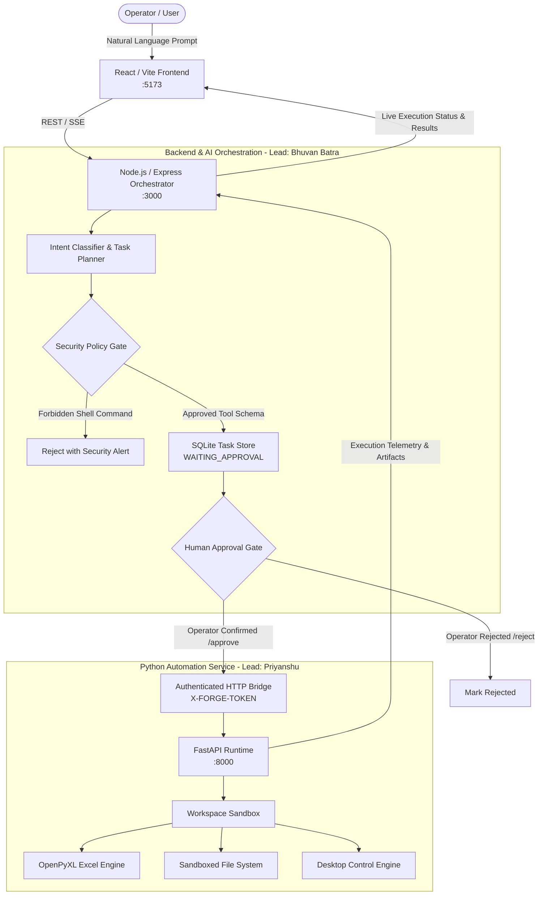

# 🔨 FORGE AI — Local Computer-Use & Desktop Task Assistant

> A secure, local computer-use assistant bridging natural-language task planning, human authorization safety gates, and sandboxed Python desktop automation.

---

## 📌 Project Overview

FORGE AI is an agentic desktop automation assistant engineered to process natural language requests, formulate structured multi-stage execution plans, enforce mandatory human approval gates, and execute verified computer operations safely within an isolated workspace sandbox.

### Core Capabilities
- **Natural Language Task Understanding**: Describe multi-step computer tasks using everyday language (`CHAT`, `TASK`, `AMBIGUOUS`).
- **Human Authorization Safety Gate**: Destructive file modifications, workbook writes, and desktop operations cannot execute without explicit operator confirmation (`/approve`).
- **Strict Security Gate**: Policy middleware blocks arbitrary terminal, shell, or powershell commands. Execution is strictly restricted to registered, validated tool schemas.
- **Inter-Service Security**: Node.js orchestrator communicates with the Python FastAPI automation runtime via mutual `X-FORGE-TOKEN` authentication.
- **Audit Logging & Telemetry**: Full lifecycle audit trails and task history stored locally in SQLite.

---

## 🏛️ System Architecture



---

## 👥 Team & Architectural Module Ownership

- **Bhuvan Batra — Backend & AI Lead**:
  - Designed and built the central Node.js/Express backend orchestration engine (`backend/src/server.js`, `backend/src/app.js`).
  - Implemented the intent routing and classification pipeline (`intentRouter.js`) with LLM integration (Groq API & Ollama fallback).
  - Developed the task planner (`taskPlanner.js`) for multi-step structured Excel, document, and desktop operations.
  - Implemented the strict Security Gate policy middleware to intercept and block arbitrary terminal/shell commands (`securityGate.js`).
  - Authored the Human Approval Gate ensuring destructive or execution operations require explicit confirmation before execution.
  - Integrated the authenticated inter-service communication bridge with the Python automation service via `X-FORGE-TOKEN`.
  - Created SQLite state persistence for conversations, tasks, and audit logs (`database.js`, `repositories.js`).
  - Developed backend integration and unit test suites (`backend/tests/test-unit.js`, `backend/tests/test-api.js`).

- **Priyanshu — Python Automation Lead**:
  - Built the FastAPI automation runtime engine (`automation/src/main.py`).
  - Implemented sandboxed file system manipulation (`file_tool.py`) with path traversal guards.
  - Created Excel workbook and formula generation tools (`excel_tool.py`) using OpenPyXL.
  - Built desktop control and application resolution engines (`desktop_tool.py`).
  - Authored automation service unit and security tests (`automation/tests/test_automation_service.py`).

- **Vansh — Frontend Lead**:
  - Developed the React / Vite frontend UI (`frontend/src/`).
  - Created the real-time chat interface, task approval modal, and execution result viewer.
  - Built responsive glassmorphism theme and status indicators.

---

## 🛠️ Technology Stack

| Layer | Technologies |
|---|---|
| **Frontend** | React, Vite, Tailwind CSS, Lucide Icons |
| **Backend Orchestrator** | Node.js, Express, Zod, SQLite (`better-sqlite3`) |
| **AI & NLP** | Groq API, Ollama (Local LLM fallback), Rule-based Planner |
| **Automation Runtime** | Python 3.11+, FastAPI, Uvicorn, Pydantic |
| **Office & Desktop Tools** | OpenPyXL (Excel), PyAutoGUI, Windows API |
| **Testing & CI** | Jest / Node test runner, Pytest, GitHub Actions |

---

## 🧪 Running Automated Tests

### 1. Backend Unit & Integration Tests (Node.js)
```bash
cd backend
npm test                # Runs full 8-stage API integration test suite
node tests/test-unit.js # Runs SQLite persistence and Security Gate unit tests
```

### 2. Automation Service Unit & Security Tests (Python)
```bash
cd automation
pytest tests/test_automation_service.py -v
```

---

## 🚀 Running the System (Windows)

### Option A: One-Click PowerShell Launcher
```powershell
.\start-forge.ps1
```
This launcher starts:
1. Python FastAPI Automation Runtime on `http://127.0.0.1:8000`
2. Node.js Express Backend on `http://127.0.0.1:3000`
3. React Vite Frontend on `http://127.0.0.1:5173`

---

### Option B: Manual Multi-Terminal Startup

**1. Python Automation Service**
```powershell
cd automation
py -m venv .venv
.\.venv\Scripts\Activate.ps1
pip install -r requirements.txt
$env:FORGE_AUTOMATION_TOKEN = "your-local-secret"
python -m uvicorn src.main:app --host 127.0.0.1 --port 8000
```
Verify at `http://127.0.0.1:8000/health`.

**2. Node.js Backend Orchestrator**
```powershell
cd backend
Copy-Item .env.example .env
npm install
npm start
```
Configure `backend/.env` with `FORGE_AUTOMATION_TOKEN=your-local-secret` matching the Python service. Backend runs on `http://127.0.0.1:3000` (health check at `/health`).

**3. React Frontend**
```powershell
cd frontend
npm install
npm run dev
```
Open `http://localhost:5173` in your browser.

---

## 🔒 Demonstration and Honesty

- **Authentic Engineering**: The repository contains the working React frontend, Node.js orchestration backend, and Python automation layer. Team members' individual contributions are strictly and transparently documented.
- **Safety First**: Destructive operations always require operator confirmation. The security policy gate blocks shell injection attempts by design.
- **No Mockups**: Verify live runtime functionality via automated integration tests and running services.

---

## 📝 License
MIT License.
